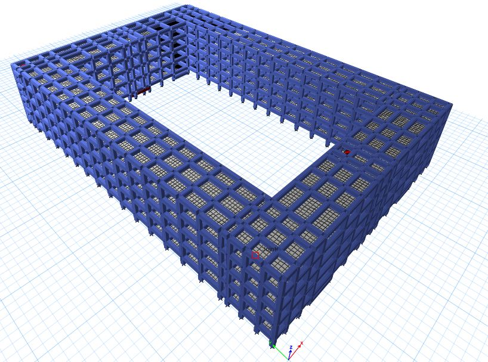
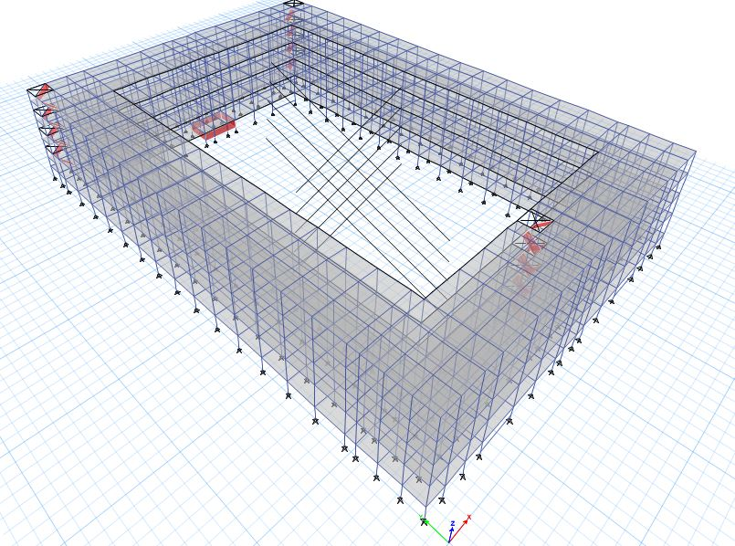
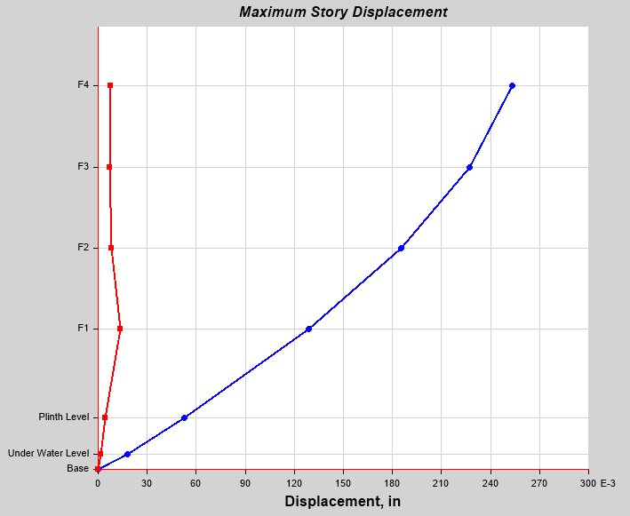
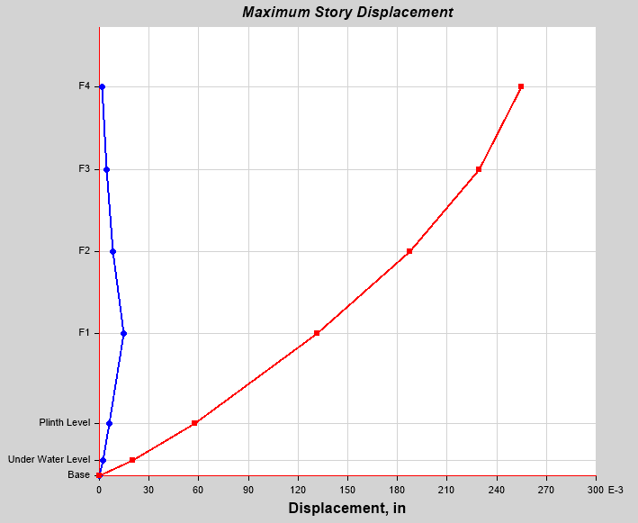
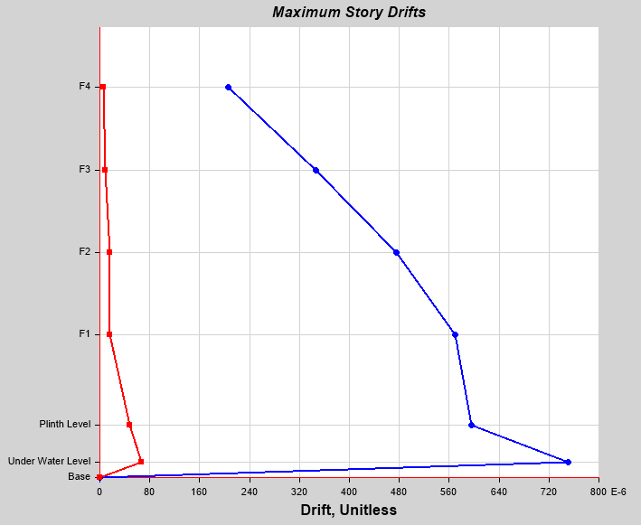
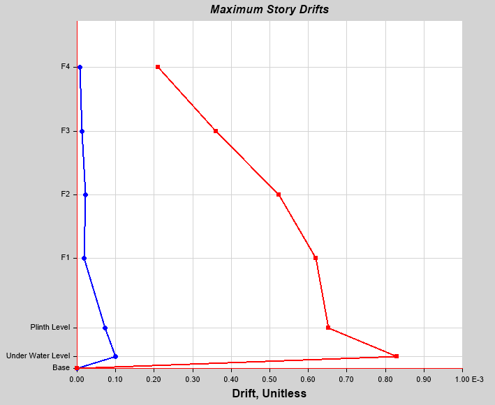
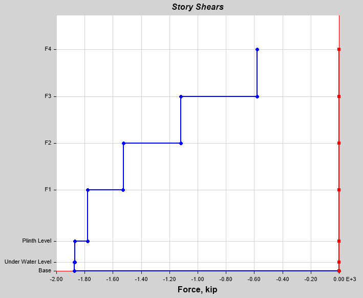
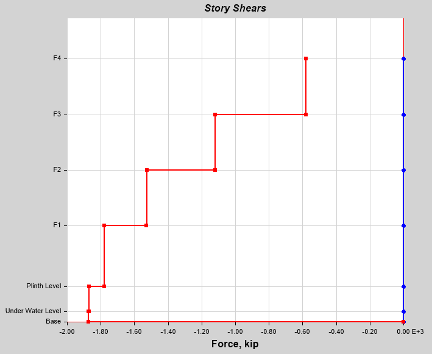
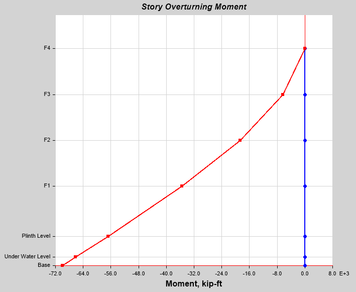
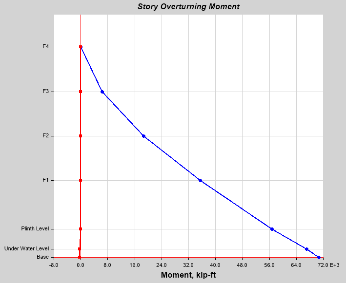

# 🏢 Reinforced Concrete Building Design & Seismic FEA: 4-Storey Multi-Storey Complex



[](https://www.csiamerica.com/products/etabs)
[](https://www.csiamerica.com/products/sap2000)
[](https://www.concrete.org/)
[](#)
[](#)
[](LICENSE)

---

## 📌 Executive Summary

This repository contains the comprehensive structural analysis, reinforced concrete design, and seismic evaluation for a **4-Storey Multi-Storey Reinforced Concrete Hotel / Student Hostel Facility (500-occupant capacity)** equipped with an integrated **$10,000\text{ Gallon}$ underground reinforced concrete water reservoir**.

Developed as a **Complex Engineering Problem (CEP)** in **CE-412: Design of Concrete Structures** (Semester 7), the project demonstrates complete compliance with **ACI 318-14 (Building Code Requirements for Structural Concrete)** and **ASCE 7-16 / Building Code of Pakistan (BCP)** for **Seismic Zone 2-B**.

The repository includes the complete **CSI ETABS 3D spatial finite element model** (`.EDB`), SAP2000 model, 53-page exhaustive calculation and design report, full structural framing and elevation DXFs, seismic drift and shear plots, modal analysis tables, and rebar Bill of Materials (BOM).

---

## 🏛️ Project Specifications & Design Criteria

| Engineering Parameter | Design Specification | Notes / Standards |
| :--- | :--- | :--- |
| **Occupancy & Building Type** | Bachelors Hotel / Student Residential Complex | 500-student accommodation capacity |
| **Storey Configuration** | 4 Storeys above grade + Plinth + Underground Water Tank | Typical floor-to-floor height: $11.0\text{ ft}$ ($3.35\text{ m}$) |
| **Underground Water Tank** | $10,000\text{ Gallons}$ capacity | Reinforced concrete walls designed for active earth & hydrostatic pressures |
| **Concrete Compressive Strength ($f'_c$)** | $3,000\text{ psi}$ (slabs/footings), $4,000\text{ psi}$ (columns/beams) | Normal weight concrete ($\gamma_c = 150\text{ pcf}$) |
| **Reinforcing Steel ($f_y$)** | $60,000\text{ psi}$ (Grade 60 Deformed Bars) | ASTM A615 high-yield deformed rebar |
| **Seismic Zone** | **Zone 2-B** ($Z = 0.20\text{g}$) | Building Code of Pakistan (BCP) / UBC 97 |
| **Structural System** | Reinforced Concrete Moment-Resisting Frame (OMRF/IMRF) | Response modification factor $R = 5.5$ |
| **Primary Software** | **CSI ETABS & CSI SAP2000** | 3D dynamic finite element modeling & frame design |

---

## 💻 3D Finite Element Modeling (CSI ETABS)



The structure was modeled in **CSI ETABS** as a 3D spatial frame with rigid diaphragm constraints at each slab level:
- **Beams & Columns**: 3D frame elements with gross and cracked section property modifiers ($I_{eff} = 0.35 I_g$ for beams, $I_{eff} = 0.70 I_g$ for columns per ACI 318-14 Section 6.6.3.1.1).
- **Floor Slabs**: Shell thin elements modeling two-way flexural behavior and in-plane diaphragm rigidity.
- **Underground Water Tank**: Hydrostatic fluid pressures combined with lateral active earth pressure acting on perimeter basement retaining walls.

---

## 🌊 Seismic Analysis & Lateral Performance Verification

Seismic lateral demands were calculated via the **Equivalent Lateral Force (ELF)** procedure and **Modal Response Spectrum Analysis**:

### 1. Inter-Story Drift & Lateral Displacement
To ensure life safety and prevent non-structural damage, inelastic inter-story drift ratios were evaluated against the ASCE 7 maximum drift limit ($\Delta_M \le 0.020 h_{sx}$):

| Response Metric | EQ-X Direction | EQ-Y Direction |
| :---: | :---: | :---: |
| **Maximum Story Displacement** |  |  |
| **Inter-Story Drift Ratio** |  |  |

*All calculated story drift ratios fall safely within code-permissible thresholds.*

### 2. Base Shear Distribution & Overturning Moments
Story shears and cumulative overturning moments were extracted across all levels:

| Seismic Action | Primary Direction (EQ-X) | Transverse Direction (EQ-Y) |
| :---: | :---: | :---: |
| **Story Shear** |  |  |
| **Overturning Moment** |  |  |

---

## 📐 Structural Member Design (ACI 318-14 LRFD)

1. **Reinforced Concrete Beams**:
   - Designed for governing factored load combinations ($1.2D + 1.6L$ and $1.2D + 1.0E + 1.0L$).
   - Flexural longitudinal rebar sized for negative support moments and positive midspan moments.
   - Closed hoop shear stirrups designed for combined shear $V_u \le \phi (V_c + V_s)$ and torsion $T_u$.
2. **Reinforced Concrete Columns**:
   - Sized for combined axial load and biaxial bending moments using $P-M-M$ interaction surfaces.
   - Tie spacing detailed for anti-buckling and seismic core confinement in end regions.
3. **Floor Slabs**:
   - Edge-supported two-way slab panels analyzed for bending moments, serviceability deflection, and minimum shrinkage/temperature rebar.
4. **Underground Water Reservoir ($10,000\text{ Gallons}$)**:
   - Surcharged earth pressure and inner hydrostatic pressure checked under two extreme cases: *Tank Full + No Soil* vs. *Tank Empty + Active Soil Pressure*.
   - Crack-width control ($w \le 0.2\text{ mm}$) to guarantee water-tightness.

---

## 📊 Quantities, Estimation & Detailing

The repository provides automated CSI Detail schedules and Bill of Materials (BOM):
- **Beam Reinforcement Schedule**: Steel tonnage, rebar diameters, and lap lengths (`results-and-quantities/Bill-Of-Materials-Concrete-Beamscsv.csv`).
- **Column Reinforcement Schedule**: Longitudinal steel ratios ($1\% \le \rho_g \le 3\%$) and transverse tie quantities (`results-and-quantities/Bill-of-Materials-Concrete-Column.csv`).
- **Slab Concrete & Steel Takeoff**: Total concrete cubic yardage and rebar weights (`results-and-quantities/Bill-of-Materials-Slabs.csv`).
- **Modal Dynamics**: Natural frequencies, modal periods, and mass participation factors (`results-and-quantities/Modal-Analysis-Frequencies-and-Periods.xlsx`).

---

## 📂 Repository File Structure

```text
Reinforced-Concrete-Building-Design-ETABS/
│
├── README.md                                  # Structural project documentation
├── LICENSE                                    # MIT License
├── .gitignore                                 # CSI solver scratch & lockfile exclusions
│
├── models/
│   ├── etabs/                                 # CSI ETABS 3D Building Models
│   │   ├── Bachelors-Hotel-Group-02.EDB       # Master analyzed ETABS building model
│   │   └── alternative-etabs-model.EDB        # Secondary verification model
│   └── sap2000/
│       └── DOSS.sdb                           # SAP2000 structural model
│
├── drawings/
│   ├── architectural/
│   │   └── Architectural-Plan-Bachelors-Hotel.dwg
│   ├── structural-3d/
│   │   └── 3D-Structural-Model.dxf
│   └── framing-and-elevations/                # Floor-by-floor structural framing DXFs
│       ├── Column-Layout-Plan---Base.dxf
│       ├── Column-Layout-Plan---F1.dxf
│       ├── Column-Layout-Plan---F2.dxf
│       ├── Column-Layout-Plan---F3.dxf
│       ├── Column-Layout-Plan---F4.dxf
│       ├── Beam-Elevation---Plinth.dxf
│       ├── Beam-Elevation---F1.dxf
│       ├── Beam-Elevation---F2.dxf
│       ├── Beam-Elevation---F3.dxf
│       ├── Beam-Elevation---F4.dxf
│       └── Beam-Elevation---Under-Water.dxf
│
├── reports-and-calculations/
│   ├── Reinforced-Concrete-Design-Report-53-Pages.pdf  # Comprehensive 53-page calculation report
│   └── ETABS-Structural-Analysis-Report.pdf            # Software analysis output tables
│
├── results-and-quantities/                    # Material takeoff and dynamics
│   ├── Modal-Analysis-Frequencies-and-Periods.xlsx
│   ├── Bill-Of-Materials-Concrete-Beamscsv.csv
│   ├── Bill-of-Materials-Concrete-Column.csv
│   ├── Bill-of-Materials-Slabs.csv
│   ├── Rebar-Quantities-Concrete-Beams.csv
│   ├── Rebar-Quantities-Concrete-Columns.csv
│   └── Rebar-Quantities-Slabs.csv
│
├── lectures-and-curriculum/                   # Full CE-412 course curriculum & lectures
│   ├── CE-412-Lecture-0-Course-Introduction.pdf
│   ├── CE-412-Lecture-1-Introduction-to-Structures.pdf
│   ├── CE-412-Lecture-2-Material-Behaviour.pdf
│   ├── CE-412-Lecture-3a-Cross-sections-Behavior-in-Flexure.pdf
│   ├── CE-412-Lecture-3b-Supplementary-Notes.pdf
│   ├── CE-412-Lecture-3c-Stress-strain-Model-Constitutive-Laws.pdf
│   ├── CE-412-Lecture-4-Analysis-and-Design-of-Beams.pdf
│   ├── CE-412-Lecture-5a-Cross-section-Behavior-in-Shear.pdf
│   └── CE-412-Lecture-5b-Member-Behavior-in-Combined-Shear-and-Flexure.pdf
│
└── media/                                     # High-resolution rendering & seismic plots
    ├── hero-building-extruded.jpg
    ├── structural-wireframe-model.jpg
    ├── story-displacement-eqx.png
    ├── story-displacement-eqy.png
    ├── story-drift-eqx.png
    ├── story-drift-eqy.png
    ├── story-shear-eqx.png
    ├── story-shear-eqy.png
    ├── overturning-moment-eqx.png
    └── overturning-moment-eqy.png
```

---

## 🛠️ Software & File Viewing Instructions

- **Viewing ETABS Models (`.EDB`)**:
  - Open in **CSI ETABS 2018 or newer**.
- **Viewing SAP2000 Models (`.sdb`)**:
  - Open in **CSI SAP2000 v20 or newer**.
- **Viewing DXF & DWG Drawings**:
  - Open in **Autodesk AutoCAD**, **Autodesk TrueView**, or [Autodesk Viewer (Free Browser Tool)](https://viewer.autodesk.com/).

---

## 👤 Author & Academic Attribution

- **Structural Designer & Analyst:** [Muhammad Umer Basit](https://github.com/MuhammadUmerBasit)  
  *Civil & Structural Engineering*
- **Design Team:** Group 02
- **Course:** CE-412: Design of Concrete Structures, Semester 7
- **Standards:** ACI 318-14, ASCE 7-16, Building Code of Pakistan (Zone 2B)

---

## 📄 License

This repository is licensed under the [MIT License](LICENSE).
